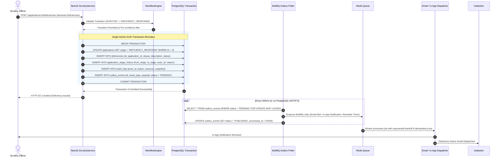

# AICTE FlowGuard — System Architecture & Technical Design

**Document Control:**
- **Project:** AICTE FlowGuard — Integrated AICTE Approval Workflow Automation, Compliance Monitoring and Alert Management System
- **Problem Statement ID:** 26262
- **Document Role:** Teammate B (Backend / Database) & Teammate D (Automation / Integration)
- **Status:** Complete Technical Architecture
- **Source Basis:** Sections 5, 6, 8, 9, 10, 11, and 12 of AICTE FlowGuard Implementation Plan

---

## 1. Architectural Strategy & Monolith Justification

To maintain rigorous regulatory provenance, ACID transactions, and deterministic state management, AICTE FlowGuard is structured as a **Modular Monolith API** paired with an **Asynchronous Queue Worker** and a **Modern Next.js Frontend**.

```
aicte-flowguard/
├── apps/
│   ├── web/               # Next.js App Router (React, Tailwind CSS, shadcn/ui)
│   ├── api/               # NestJS Modular Monolith REST API
│   └── worker/            # BullMQ Background Processing & Reconciliation Engine
└── packages/
    ├── shared-types/      # Shared TypeScript DTOs, Enums, and Constants
    ├── workflow-contracts/# Stage transition contracts and FSM definitions
    └── prisma/            # Single Prisma Schema, Migrations, and Seeders
```

### Why a Modular Monolith over Microservices?
1. **Atomic Case Transitions:** Transitioning an application state requires updating `applications`, appending to `application_stage_history`, recording a tamper-evident entry in `audit_logs`, and enqueuing an `outbox_events` record. Doing this across distributed microservices introduces two-phase commit overhead and distributed transaction failure modes.
2. **Deterministic Data Integrity:** Foreign key constraints, unique indexes, and row-level locking (`SELECT ... FOR UPDATE`) in PostgreSQL prevent concurrency races during simultaneous committee actions.
3. **Dedicated Asynchronous Worker:** Scheduled deadlines and cron jobs run on a dedicated worker process so scheduled reminders and overdue escalations execute reliably independent of browser sessions.

---

## 2. High-Level System Architecture Diagram

```
+-----------------------------------------------------------------------------------+
|                                  USER CLIENTS                                     |
|  Institution | Regional Officer | Bureau Officer | Scrutiny Officer | EVC Expert  |
|  SAC / SHC Bench | Competent Authority (Council) | System Administrator | Auditor  |
+-----------------------------------------------------------------------------------+
                                         |
                                         | HTTPS / JSON (REST + SSE)
                                         v
+-----------------------------------------------------------------------------------+
|                        FRONTEND WEB APPLICATION (Next.js)                         |
|  - Role-Aware Sidebar & Global Navigation                                         |
|  - Scrutiny & Deficiency Workspace (Split-Pane Document Viewer)                   |
|  - EVC Logistics & Conflict Verification Calendar                                 |
|  - Real-Time Compliance & Lease Expiry Dashboard                                  |
|  - Notification Center (In-App Badges & Deep Links)                               |
+-----------------------------------------------------------------------------------+
                                         |
                                         | Authenticated REST API (JWT / Session Cookie)
                                         v
+-----------------------------------------------------------------------------------+
|                    BACKEND REST API (NestJS Modular Monolith)                     |
|                                                                                   |
|  [Auth & RBAC Guard] <----> [Multi-Tenant Scope Interceptor (Region / Inst)]     |
|                                                                                   |
|  +--------------------+  +--------------------+  +-----------------------------+  |
|  | ApplicationService |  |  WorkflowEngine    |  | Scrutiny & DeficiencyService|  |
|  +--------------------+  +--------------------+  +-----------------------------+  |
|  | EVCService         |  |  CommitteeService  |  | ComplianceObligationService |  |
|  +--------------------+  +--------------------+  +-----------------------------+  |
|  | DocumentService    |  |  AuditLogService   |  | OutboxPublisherService      |  |
|  +--------------------+  +--------------------+  +-----------------------------+  |
|                                         |                                         |
|                     ACID Database Transaction Boundary                            |
|                     (Case + StageHistory + Audit + Outbox)                        |
|                                         |                                         |
+-----------------------------------------|-----------------------------------------+
                                          |
                      +-------------------+-------------------+
                      |                                       |
                      v                                       v
+---------------------------------------+   +---------------------------------------+
|        PRIMARY RELATIONAL DB          |   |        OBJECT STORAGE (S3/MinIO)      |
|           PostgreSQL 16               |   |  - Private S3 Bucket                  |
|  - applications & stage history       |   |  - Mandatory SHA-256 Checksums        |
|  - deficiencies & EVC reports         |   |  - Short-Lived Pre-Signed URLs        |
|  - compliance obligations & expiry    |   |  - Preserved Historical Versions      |
|  - outbox_events (Transactional)      |   +---------------------------------------+
|  - audit_logs (Append-Only)           |
+---------------------------------------+
                      |
                      | Polled / Published via Transactional Outbox
                      v
+-----------------------------------------------------------------------------------+
|                        ASYNCHRONOUS WORKER (BullMQ + Redis)                       |
|                                                                                   |
|  +-----------------------+  +----------------------+  +------------------------+  |
|  | Outbox Poller Worker  |  | Deadline & Reminder  |  | Overdue Escalation     |  |
|  | (Dispatches to Redis) |  | Worker (T-7d, T-3d)  |  | Worker (+2d, +5d)      |  |
|  +-----------------------+  +----------------------+  +------------------------+  |
|  | Document Expiry Watch |  | Periodic 60m Recon   |  | Email Provider Adapter |  |
|  | (180d, 90d, 30d, 7d)  |  | Worker (Anti-Stuck)  |  | (Resend / SMTP / Mock) |  |
|  +-----------------------+  +----------------------+  +------------------------+  |
+-----------------------------------------------------------------------------------+
```

---

## 3. Transactional Outbox Pattern & Event Lifecycle

To prevent silent failures, lost emails, and inconsistent states during network partitions or worker restarts, state mutations follow the **Transactional Outbox Pattern**:



---

## 4. NestJS Modular Monolith Architecture

The backend API is organized into domain-driven modules with strict dependency boundaries:

```
apps/api/src/
├── auth/                       # Authentication, JWT strategy, session handling
├── users/                      # User profiles and demo user seeding
├── roles/                      # RBAC definitions and permissions
├── institutions/              # Institution profiles, regions, and boundaries
├── applications/               # Application lifecycle, drafts, submission
├── workflow/                   # Core FSM state machine and transition guards
├── scrutiny/                   # Scrutiny checklist, observations, deficiencies
├── evc/                        # EVC scheduling, conflict checks, report uploads
├── committees/                 # SHC / SAC docketing, minutes, recommendations
├── compliance/                 # Compliance obligations, 4D statuses, reminders
├── documents/                  # S3 integration, presigned URLs, SHA-256 checks
├── notifications/              # In-app alerts, outbox publisher, SSE streams
├── escalations/                # SLA calculation, level 1/2 escalation logic
├── reports/                    # Aggregated KPI queries, pendency, ageing
├── audit/                      # Append-only audit logger and query endpoints
├── rules/                      # Versioned APH rule engine
├── common/
│   ├── guards/                 # JwtAuthGuard, RolesGuard, ScopeGuard
│   ├── interceptors/          # AuditInterceptor, TransformInterceptor
│   └── filters/                # GlobalHttpExceptionFilter
└── main.ts                     # Application bootstrap & Swagger documentation
```

### 4.1 Transition Service Implementation Pattern

Every workflow transition must invoke `WorkflowEngineService.executeTransition()` to enforce invariants:

```typescript
// apps/api/src/workflow/workflow-engine.service.ts
import { Injectable, BadRequestException, ForbiddenException } from '@nestjs/common';
import { PrismaService } from '../prisma/prisma.service';

export interface TransitionContext {
  applicationId: string;
  targetStage: string;
  actorUserId: string;
  actorRole: string;
  reason?: string;
  evidencePayload?: Record<string, any>;
}

@Injectable()
export class WorkflowEngineService {
  constructor(private readonly prisma: PrismaService) {}

  async executeTransition(ctx: TransitionContext) {
    return await this.prisma.$transaction(async (tx) => {
      // 1. Fetch case with pessimistic write lock
      const application = await tx.application.findUniqueOrThrow({
        where: { id: ctx.applicationId },
      });

      // 2. Validate current stage allows transition to target stage
      const workflowRule = await tx.workflowTransitionRule.findFirst({
        where: {
          fromStage: application.currentStage,
          toStage: ctx.targetStage,
          workflowVersion: application.workflowVersion,
        },
      });

      if (!workflowRule) {
        throw new BadRequestException(
          `Invalid transition from ${application.currentStage} to ${ctx.targetStage}`,
        );
      }

      // 3. Verify actor role authorization
      if (!workflowRule.allowedRoles.includes(ctx.actorRole)) {
        throw new ForbiddenException(
          `Role ${ctx.actorRole} is not authorized for transition ${workflowRule.transitionName}`,
        );
      }

      // 4. Update application state
      const updatedApp = await tx.application.update({
        where: { id: ctx.applicationId },
        data: {
          currentStage: ctx.targetStage,
          version: { increment: 1 }, // Optimistic concurrency counter
          updatedAt: new Date(),
        },
      });

      // 5. Append immutable stage history
      await tx.applicationStageHistory.create({
        data: {
          applicationId: ctx.applicationId,
          fromStage: application.currentStage,
          toStage: ctx.targetStage,
          actorUserId: ctx.actorUserId,
          reason: ctx.reason,
          workflowVersion: application.workflowVersion,
        },
      });

      // 6. Record append-only audit event
      await tx.auditLog.create({
        data: {
          actorUserId: ctx.actorUserId,
          actionType: `TRANSITION_${workflowRule.transitionName}`,
          resourceType: 'APPLICATION',
          resourceId: ctx.applicationId,
          beforeState: { stage: application.currentStage },
          afterState: { stage: ctx.targetStage },
        },
      });

      // 7. Insert outbox event for reliable asynchronous processing
      await tx.outboxEvent.create({
        data: {
          eventType: `APPLICATION_${workflowRule.transitionName}`,
          aggregateType: 'APPLICATION',
          aggregateId: ctx.applicationId,
          payload: {
            applicationId: ctx.applicationId,
            fromStage: application.currentStage,
            toStage: ctx.targetStage,
            actorUserId: ctx.actorUserId,
            timestamp: new Date().toISOString(),
          },
          status: 'PENDING',
        },
      });

      return updatedApp;
    });
  }
}
```

---

## 5. Background Worker & Reconciliation Pipeline

The BullMQ worker subsystem runs in a separate Node.js process (`apps/worker`), providing:

1. **Outbox Event Publisher (`outbox.worker.ts`):** Polls the `outbox_events` table every 500ms and pushes messages to designated Redis BullMQ queues.
2. **Reminder Scheduler (`reminder.worker.ts`):** Calculates reminder offsets (e.g., T-7 days, T-3 days, T-0 due date). Sets delayed BullMQ jobs using unique idempotency keys (`applicationId:reminderType:deadlineDate`).
3. **Escalation Engine (`escalation.worker.ts`):** Fires alerts when tasks exceed SLAs:
   - **Level 1 Escalation (+2 days overdue):** Dispatches alert to Queue Supervisor.
   - **Level 2 Escalation (+5 days overdue):** Dispatches escalation to Regional Director and Bureau Head.
4. **Document Expiry Sentinel (`expiry.worker.ts`):** Runs daily at 00:01 UTC to scan for certificates entering `EXPIRING_SOON` thresholds (180, 90, 30, and 7 days).
5. **Periodic Reconciliation Cron (`reconciliation.worker.ts`):** Runs every 60 minutes to detect:
   - Open obligations past due date not marked `OVERDUE`.
   - Stuck outbox events older than 5 minutes.
   - Cancelled tasks whose delayed BullMQ jobs still exist in Redis.
