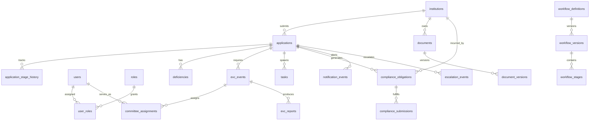

# AICTE FlowGuard — Database Design & Schema Specifications

**Document Control:**
- **Project:** AICTE FlowGuard (Problem Statement ID: 26262)
- **Document Role:** Teammate B (Backend / Database)
- **Status:** Complete Production-Ready Schema
- **Target RDBMS:** PostgreSQL 16+ via Prisma ORM 5.x
- **Source Basis:** Sections 8, 9, 10, 11, and 12 of AICTE FlowGuard Implementation Plan

---

## 1. Relational Data Model Overview

The database architecture is built around three core pillars:
1. **Deterministic Relational State & Provenance:** Foreign keys, unique constraints, and check constraints guarantee relational integrity across institutions, applications, scrutiny reviews, EVC inspections, and compliance tracking.
2. **Immutable Audit Ledger & Outbox Reliability:** Append-only tables (`audit_logs`, `application_stage_history`, `outbox_events`) ensure full legal defensibility, non-repudiation, and transactional messaging reliability.
3. **Four-Dimensional Compliance Dimensions:** `compliance_obligations` decouples submission status, verification status, document validity, and overall compliance status to prevent premature obligation closures.

---

## 2. Entity-Relationship Diagram (ERD)



---

## 3. Complete Prisma Schema (`schema.prisma`)

Below is the complete, valid Prisma schema for AICTE FlowGuard:

```prisma
datasource db {
  provider = "postgresql"
  url      = env("DATABASE_URL")
}

generator client {
  provider = "prisma-client-js"
}

// ==========================================
// 1. IDENTITY, ROLES & ORGANIZATIONS
// ==========================================

enum UserRoleCode {
  ROLE_INSTITUTION
  ROLE_REGIONAL_OFFICER
  ROLE_BUREAU_OFFICER
  ROLE_SCRUTINY_OFFICER
  ROLE_EVC_COORDINATOR
  ROLE_EVC_MEMBER
  ROLE_SAC_SHC
  ROLE_COMPETENT_AUTHORITY
  ROLE_SYSTEM_ADMIN
  ROLE_AUDITOR
}

enum AccountStatus {
  ACTIVE
  SUSPENDED
  INVITED
  DEACTIVATED
}

model User {
  id               String         @id @default(uuid()) @db.Uuid
  email            String         @unique @db.VarChar(255)
  passwordHash     String         @db.VarChar(255)
  fullName         String         @db.VarChar(255)
  phone            String?        @db.VarChar(50)
  designation      String?        @db.VarChar(100)
  accountStatus    AccountStatus  @default(ACTIVE)
  
  institutionId    String?        @db.Uuid
  institution      Institution?   @relation(fields: [institutionId], references: [id])
  
  regionId         String?        @db.Uuid
  region           Region?        @relation(fields: [regionId], references: [id])
  
  userRoles        UserRole[]
  assignedTasks    Task[]         @relation("TaskAssignee")
  stageHistory     ApplicationStageHistory[]
  committeeAssignments CommitteeAssignment[]
  auditLogs        AuditLog[]
  evcReports       EvcReport[]
  
  createdAt        DateTime       @default(now()) @db.Timestamptz(6)
  updatedAt        DateTime       @updatedAt @db.Timestamptz(6)

  @@index([email])
  @@index([institutionId])
  @@index([regionId])
  @@map("users")
}

model Role {
  id               String         @id @default(uuid()) @db.Uuid
  code             UserRoleCode   @unique
  name             String         @db.VarChar(100)
  description      String?        @db.Text
  
  userRoles        UserRole[]
  rolePermissions  RolePermission[]

  @@map("roles")
}

model Permission {
  id               String         @id @default(uuid()) @db.Uuid
  code             String         @unique @db.VarChar(100)
  name             String         @db.VarChar(150)
  description      String?        @db.Text
  
  rolePermissions  RolePermission[]

  @@map("permissions")
}

model RolePermission {
  roleId           String         @db.Uuid
  permissionId     String         @db.Uuid
  
  role             Role           @relation(fields: [roleId], references: [id], onDelete: Cascade)
  permission       Permission     @relation(fields: [permissionId], references: [id], onDelete: Cascade)

  @@id([roleId, permissionId])
  @@map("role_permissions")
}

model UserRole {
  userId           String         @db.Uuid
  roleId           String         @db.Uuid
  assignedAt       DateTime       @default(now()) @db.Timestamptz(6)
  
  user             User           @relation(fields: [userId], references: [id], onDelete: Cascade)
  role             Role           @relation(fields: [roleId], references: [id], onDelete: Cascade)

  @@id([userId, roleId])
  @@map("user_roles")
}

model Region {
  id               String         @id @default(uuid()) @db.Uuid
  code             String         @unique @db.VarChar(50) // e.g. "NORTH_WEST", "SOUTH", "WEST"
  name             String         @db.VarChar(100)
  headquartersCity String         @db.VarChar(100)
  
  users            User[]
  institutions     Institution[]
  applications     Application[]

  @@map("regions")
}

model Institution {
  id               String         @id @default(uuid()) @db.Uuid
  aictePermanentId String         @unique @db.VarChar(50)
  legalEntityName  String         @db.VarChar(255)
  institutionType  String         @db.VarChar(100) // Engineering, Management, Pharmacy, Polytechnic
  addressLine1     String         @db.VarChar(255)
  city             String         @db.VarChar(100)
  state            String         @db.VarChar(100)
  postalCode       String         @db.VarChar(20)
  landAreaAcres    Decimal        @db.Decimal(10, 2)
  isRural          Boolean        @default(false)
  
  regionId         String         @db.Uuid
  region           Region         @relation(fields: [regionId], references: [id])
  
  users            User[]
  applications     Application[]
  documents        Document[]
  complianceObligations ComplianceObligation[]

  createdAt        DateTime       @default(now()) @db.Timestamptz(6)
  updatedAt        DateTime       @updatedAt @db.Timestamptz(6)

  @@index([aictePermanentId])
  @@index([regionId])
  @@map("institutions")
}

// ==========================================
// 2. APPLICATIONS & WORKFLOW ENGINE
// ==========================================

enum ApplicationCategory {
  NEW_INSTITUTION_LOA
  ROUTINE_EOA
  EOA_SUBSTANTIVE_CHANGES
  STANDALONE_PROGRAM_CLOSURE
  CHANGE_OF_SITE
  CHANGE_OF_NAME
}

enum ApplicationStageCode {
  DRAFT
  SUBMITTED
  SCRUTINY
  DEFICIENCY_RESPONSE
  RE_SCRUTINY
  EVC_PENDING
  EVC_SCHEDULED
  EVC_REVIEW
  HEARING_OR_COMMITTEE_REVIEW
  DECISION_PENDING
  CLOSED_APPROVED
  CLOSED_REJECTED
}

model Application {
  id                     String               @id @default(uuid()) @db.Uuid
  applicationNumber      String               @unique @db.VarChar(50)
  academicYear           String               @db.VarChar(20) // e.g. "2026-2027"
  category               ApplicationCategory
  currentStage           ApplicationStageCode @default(DRAFT)
  version                Int                  @default(1) // Optimistic locking
  
  institutionId          String               @db.Uuid
  institution            Institution          @relation(fields: [institutionId], references: [id])
  
  regionId               String               @db.Uuid
  region                 Region               @relation(fields: [regionId], references: [id])
  
  workflowVersionId      String               @db.Uuid
  workflowVersion        WorkflowVersion      @relation(fields: [workflowVersionId], references: [id])
  
  assignedScrutinyOfficerId String?           @db.Uuid
  
  submittedAt            DateTime?            @db.Timestamptz(6)
  decisionUploadedAt     DateTime?            @db.Timestamptz(6)
  appealWindowClosesAt   DateTime?            @db.Timestamptz(6)
  isAppealExhausted      Boolean              @default(false)
  
  applicationPayload     Json                 @default("{}") // Structured application data
  
  stageHistory           ApplicationStageHistory[]
  tasks                  Task[]
  deficiencies           Deficiencies[]
  evcEvents              EvcEvent[]
  documents              Document[]
  complianceObligations  ComplianceObligation[]
  notificationEvents     NotificationEvent[]
  escalationEvents       EscalationEvent[]

  createdAt              DateTime             @default(now()) @db.Timestamptz(6)
  updatedAt              DateTime             @updatedAt @db.Timestamptz(6)

  @@index([applicationNumber])
  @@index([institutionId])
  @@index([currentStage])
  @@index([regionId])
  @@map("applications")
}

model WorkflowDefinition {
  id               String            @id @default(uuid()) @db.Uuid
  key              String            @unique @db.VarChar(100) // e.g. "TEMPLATE_A_LOA"
  name             String            @db.VarChar(200)
  description      String?           @db.Text
  
  versions         WorkflowVersion[]

  @@map("workflow_definitions")
}

model WorkflowVersion {
  id               String               @id @default(uuid()) @db.Uuid
  workflowId       String               @db.Uuid
  workflow         WorkflowDefinition   @relation(fields: [workflowId], references: [id])
  versionNumber    Int
  effectiveFrom    DateTime             @db.Timestamptz(6)
  effectiveTo      DateTime?            @db.Timestamptz(6)
  isActive         Boolean              @default(true)
  
  applications     Application[]
  stages           WorkflowStage[]
  transitionRules  WorkflowTransitionRule[]

  @@unique([workflowId, versionNumber])
  @@map("workflow_versions")
}

model WorkflowStage {
  id               String               @id @default(uuid()) @db.Uuid
  workflowVersionId String              @db.Uuid
  workflowVersion  WorkflowVersion      @relation(fields: [workflowVersionId], references: [id])
  code             ApplicationStageCode
  name             String               @db.VarChar(100)
  ownerRole        UserRoleCode
  slaHours         Int                  @default(72)
  isTerminal       Boolean              @default(false)

  @@unique([workflowVersionId, code])
  @@map("workflow_stages")
}

model WorkflowTransitionRule {
  id                String               @id @default(uuid()) @db.Uuid
  workflowVersionId String               @db.Uuid
  workflowVersion   WorkflowVersion      @relation(fields: [workflowVersionId], references: [id])
  transitionName    String               @db.VarChar(100)
  fromStage         ApplicationStageCode
  toStage           ApplicationStageCode
  allowedRoles      UserRoleCode[]
  requiredCondition Json                 @default("{}")

  @@map("workflow_transition_rules")
}

model ApplicationStageHistory {
  id               String               @id @default(uuid()) @db.Uuid
  applicationId    String               @db.Uuid
  application      Application          @relation(fields: [applicationId], references: [id], onDelete: Cascade)
  fromStage        ApplicationStageCode
  toStage          ApplicationStageCode
  actorUserId      String               @db.Uuid
  actor            User                 @relation(fields: [actorUserId], references: [id])
  reason           String?              @db.Text
  workflowVersion  String?              @db.VarChar(50)
  timestamp        DateTime             @default(now()) @db.Timestamptz(6)

  @@index([applicationId])
  @@index([timestamp])
  @@map("application_stage_history")
}

// ==========================================
// 3. SCRUTINY & DEFICIENCIES
// ==========================================

enum DeficiencyStatus {
  OPEN
  RESUBMITTED
  RESOLVED
  EXPIRED_UNRESOLVED
}

model Deficiencies {
  id               String               @id @default(uuid()) @db.Uuid
  applicationId    String               @db.Uuid
  application      Application          @relation(fields: [applicationId], references: [id], onDelete: Cascade)
  
  aphClause        String               @db.VarChar(100)
  description      String               @db.Text
  requiredRemediation String             @db.Text
  status           DeficiencyStatus     @default(OPEN)
  
  issuedAt         DateTime             @default(now()) @db.Timestamptz(6)
  dueAt            DateTime             @db.Timestamptz(6)
  resolvedAt       DateTime?            @db.Timestamptz(6)
  
  institutionNotes String?              @db.Text
  rectifiedDocumentKey String?          @db.VarChar(255)

  @@index([applicationId])
  @@index([status])
  @@map("deficiencies")
}

model Task {
  id               String               @id @default(uuid()) @db.Uuid
  applicationId    String               @db.Uuid
  application      Application          @relation(fields: [applicationId], references: [id], onDelete: Cascade)
  title            String               @db.VarChar(200)
  taskType         String               @db.VarChar(100) // SCRUTINY_REVIEW, EVC_REPORT, etc.
  assignedUserId   String               @db.Uuid
  assignedUser     User                 @relation("TaskAssignee", fields: [assignedUserId], references: [id])
  isCompleted      Boolean              @default(false)
  dueAt            DateTime             @db.Timestamptz(6)
  completedAt      DateTime?            @db.Timestamptz(6)

  @@index([applicationId])
  @@index([assignedUserId])
  @@map("tasks")
}

// ==========================================
// 4. EVC (EXPERT VISIT COMMITTEE)
// ==========================================

enum EvcStatus {
  PENDING
  SCHEDULED
  VISIT_COMPLETED
  REPORT_SUBMITTED
  CANCELLED
}

enum EvcMode {
  PHYSICAL
  VIRTUAL
  HYBRID
}

enum CommitteeRole {
  CHAIRMAN
  SUBJECT_EXPERT
  ARCHITECT_MEMBER
}

model EvcEvent {
  id               String               @id @default(uuid()) @db.Uuid
  applicationId    String               @db.Uuid
  application      Application          @relation(fields: [applicationId], references: [id], onDelete: Cascade)
  status           EvcStatus            @default(PENDING)
  mode             EvcMode              @default(PHYSICAL)
  scheduledDate    DateTime?            @db.Date
  locationAddress  String?              @db.Text
  virtualMeetingUrl String?             @db.VarChar(500)
  coordinatorNotes String?              @db.Text
  completedAt      DateTime?            @db.Timestamptz(6)
  
  assignments      CommitteeAssignment[]
  reports          EvcReport[]

  createdAt        DateTime             @default(now()) @db.Timestamptz(6)
  updatedAt        DateTime             @updatedAt @db.Timestamptz(6)

  @@index([applicationId])
  @@map("evc_events")
}

model CommitteeAssignment {
  id               String               @id @default(uuid()) @db.Uuid
  evcEventId       String               @db.Uuid
  evcEvent         EvcEvent             @relation(fields: [evcEventId], references: [id], onDelete: Cascade)
  memberUserId     String               @db.Uuid
  member           User                 @relation(fields: [memberUserId], references: [id])
  assignmentRole   CommitteeRole
  isConflictChecked Boolean             @default(false)
  assignedAt       DateTime             @default(now()) @db.Timestamptz(6)

  @@unique([evcEventId, memberUserId])
  @@map("committee_assignments")
}

model EvcReport {
  id               String               @id @default(uuid()) @db.Uuid
  evcEventId       String               @db.Uuid
  evcEvent         EvcEvent             @relation(fields: [evcEventId], references: [id], onDelete: Cascade)
  submittedByUserId String              @db.Uuid
  submittedBy      User                 @relation(fields: [submittedByUserId], references: [id])
  
  isApproved       Boolean              // Recommendation
  observations     String               @db.Text
  videoRecordingUrl String?             @db.VarChar(500)
  geotaggedPhotoKeys String[]           // Array of S3 keys
  reportPdfKey     String               @db.VarChar(255)
  submittedAt      DateTime             @default(now()) @db.Timestamptz(6)

  @@index([evcEventId])
  @@map("evc_reports")
}

// ==========================================
// 5. DOCUMENTS & STORAGE
// ==========================================

enum DocumentCategory {
  REGISTERED_LAND_LEASE
  FIRE_SAFETY_NOC
  STRUCTURAL_STABILITY_CERTIFICATE
  AFFILIATING_UNIVERSITY_NOC
  STATE_GOVERNMENT_NOC
  BUILDING_PLAN_APPROVAL
  FDR_SECURITY_DEPOSIT
  NBA_ACCREDITATION_CERTIFICATE
}

model Document {
  id               String               @id @default(uuid()) @db.Uuid
  institutionId    String               @db.Uuid
  institution      Institution          @relation(fields: [institutionId], references: [id])
  applicationId    String?              @db.Uuid
  application      Application?         @relation(fields: [applicationId], references: [id])
  category         DocumentCategory
  currentVersionNumber Int              @default(1)
  
  validFrom        DateTime?            @db.Date
  validTo          DateTime?            @db.Date // Expiry date for lease/NOC
  isExpiryMonitored Boolean             @default(false)
  
  versions         DocumentVersion[]
  complianceObligations ComplianceObligation[]

  createdAt        DateTime             @default(now()) @db.Timestamptz(6)
  updatedAt        DateTime             @updatedAt @db.Timestamptz(6)

  @@index([institutionId])
  @@index([applicationId])
  @@index([category])
  @@map("documents")
}

model DocumentVersion {
  id               String               @id @default(uuid()) @db.Uuid
  documentId       String               @db.Uuid
  document         Document             @relation(fields: [documentId], references: [id], onDelete: Cascade)
  versionNumber    Int
  fileName         String               @db.VarChar(255)
  fileSizeBytes    BigInt
  mimeType         String               @db.VarChar(100)
  s3ObjectKey      String               @db.VarChar(500)
  sha256Checksum   String               @db.VarChar(64)
  uploadedAt       DateTime             @default(now()) @db.Timestamptz(6)

  @@unique([documentId, versionNumber])
  @@map("document_versions")
}

// ==========================================
// 6. COMPLIANCE OBLIGATIONS (4D MODEL)
// ==========================================

enum SubmissionStatus {
  NOT_SUBMITTED
  SUBMITTED
  RESUBMISSION_REQUIRED
}

enum VerificationStatus {
  PENDING
  VERIFIED
  REJECTED
  NEEDS_CORRECTION
}

enum ValidityStatus {
  VALID
  EXPIRING_SOON
  EXPIRED
  UNKNOWN
}

enum ComplianceStatus {
  OPEN
  SUBMITTED
  UNDER_REVIEW
  FULFILLED
  OVERDUE
}

model ComplianceObligation {
  id                 String             @id @default(uuid()) @db.Uuid
  institutionId      String             @db.Uuid
  institution        Institution        @relation(fields: [institutionId], references: [id])
  applicationId      String?            @db.Uuid
  application        Application?       @relation(fields: [applicationId], references: [id])
  documentId         String?            @db.Uuid
  document           Document?          @relation(fields: [documentId], references: [id])
  
  title              String             @db.VarChar(200)
  aphClauseReference String             @db.VarChar(100)
  dueAt              DateTime           @db.Timestamptz(6)
  
  // 4-Dimensional Status Architecture
  submissionStatus   SubmissionStatus   @default(NOT_SUBMITTED)
  verificationStatus VerificationStatus @default(PENDING)
  validityStatus     ValidityStatus     @default(VALID)
  complianceStatus   ComplianceStatus   @default(OPEN)
  
  submissions        ComplianceSubmission[]

  createdAt          DateTime           @default(now()) @db.Timestamptz(6)
  updatedAt          DateTime           @updatedAt @db.Timestamptz(6)

  @@index([institutionId])
  @@index([dueAt])
  @@index([complianceStatus])
  @@map("compliance_obligations")
}

model ComplianceSubmission {
  id                 String             @id @default(uuid()) @db.Uuid
  obligationId       String             @db.Uuid
  obligation         ComplianceObligation @relation(fields: [obligationId], references: [id], onDelete: Cascade)
  submittedDocKey    String             @db.VarChar(500)
  submittedAt        DateTime           @default(now()) @db.Timestamptz(6)
  reviewerNotes      String?            @db.Text
  verifiedAt         DateTime?          @db.Timestamptz(6)

  @@index([obligationId])
  @@map("compliance_submissions")
}

// ==========================================
// 7. NOTIFICATIONS, OUTBOX & ESCALATION
// ==========================================

enum OutboxStatus {
  PENDING
  PROCESSING
  PUBLISHED
  FAILED
}

model OutboxEvent {
  id               String               @id @default(uuid()) @db.Uuid
  eventType        String               @db.VarChar(100)
  aggregateType    String               @db.VarChar(100)
  aggregateId      String               @db.Uuid
  payload          Json
  status           OutboxStatus         @default(PENDING)
  retryCount       Int                  @default(0)
  lastError        String?              @db.Text
  createdAt        DateTime             @default(now()) @db.Timestamptz(6)
  processedAt      DateTime?            @db.Timestamptz(6)

  @@index([status, createdAt])
  @@map("outbox_events")
}

enum NotificationChannel {
  IN_APP
  EMAIL
}

enum NotificationStatus {
  QUEUED
  SENT
  FAILED
  READ
}

model NotificationEvent {
  id               String               @id @default(uuid()) @db.Uuid
  recipientUserId  String               @db.Uuid
  applicationId    String?              @db.Uuid
  application      Application?         @relation(fields: [applicationId], references: [id])
  channel          NotificationChannel
  title            String               @db.VarChar(200)
  body             String               @db.Text
  status           NotificationStatus   @default(QUEUED)
  sentAt           DateTime?            @db.Timestamptz(6)
  readAt           DateTime?            @db.Timestamptz(6)
  deepLinkUrl      String?              @db.VarChar(500)

  createdAt        DateTime             @default(now()) @db.Timestamptz(6)

  @@index([recipientUserId, status])
  @@map("notification_events")
}

model EscalationEvent {
  id               String               @id @default(uuid()) @db.Uuid
  applicationId    String               @db.Uuid
  application      Application          @relation(fields: [applicationId], references: [id])
  escalationLevel  Int                  // 1 = Supervisor, 2 = Regional Director / Bureau Head
  triggerReason    String               @db.VarChar(255)
  escalatedToUserId String              @db.Uuid
  resolvedAt       DateTime?            @db.Timestamptz(6)
  createdAt        DateTime             @default(now()) @db.Timestamptz(6)

  @@index([applicationId])
  @@map("escalation_events")
}

// ==========================================
// 8. AUDIT LEDGER (APPEND-ONLY)
// ==========================================

model AuditLog {
  id               String               @id @default(uuid()) @db.Uuid
  actorUserId      String               @db.Uuid
  actor            User                 @relation(fields: [actorUserId], references: [id])
  actionType       String               @db.VarChar(100)
  resourceType     String               @db.VarChar(100)
  resourceId       String               @db.Uuid
  beforeState      Json?
  afterState       Json?
  clientIp         String?              @db.VarChar(50)
  userAgent        String?              @db.VarChar(500)
  timestamp        DateTime             @default(now()) @db.Timestamptz(6)

  @@index([resourceId])
  @@index([actorUserId])
  @@index([timestamp])
  @@map("audit_logs")
}
```
