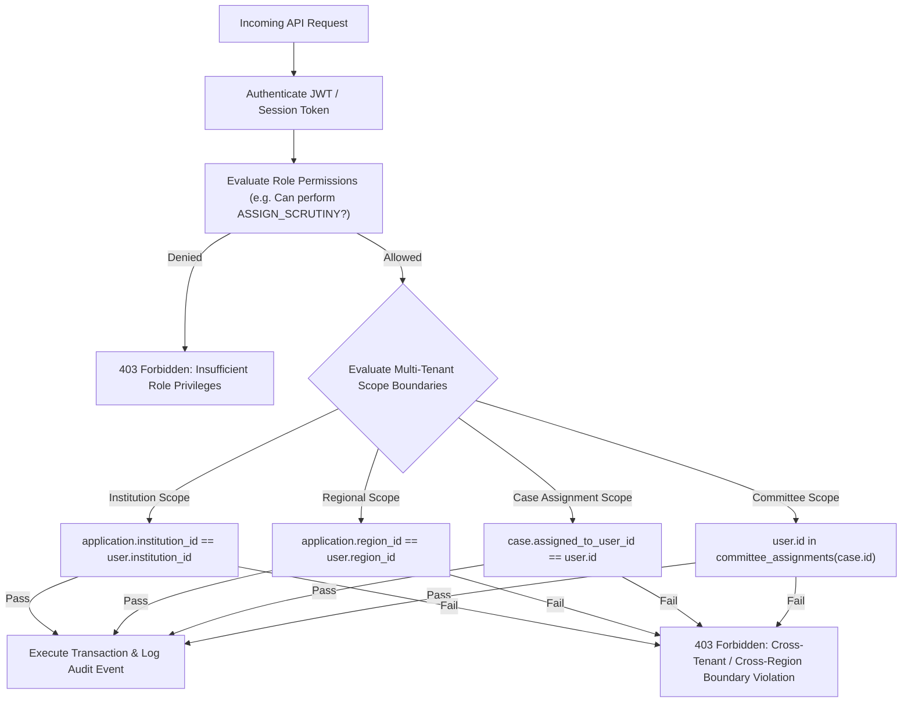

# AICTE FlowGuard — Role-Based Access Control (RBAC) Matrix & Scoping Specifications

**Document Control:**
- **Project:** AICTE FlowGuard (Problem Statement ID: 26262)
- **Document Role:** Teammate 1 (Product / APH Mapping)
- **Status:** Baseline Approved
- **Primary Source:** AICTE FlowGuard Implementation Plan & Supplied RBAC Architecture
- **Security Rule:** Server-side enforcement on every protected route and mutation. A hidden button is never an access control.

---

## 1. System Roles & Scope Taxonomy

FlowGuard manages 10 discrete roles. Access authorization requires evaluating both the **Subject Role** and the **Target Resource Scope Boundary**:

| Role Code | Role Display Name | Multi-Tenancy Scope Boundary | Authority Class |
| :--- | :--- | :--- | :--- |
| `ROLE_INSTITUTION` | Institution Representative | `institution_id == user.institution_id` | Applicant / Institutional Owner |
| `ROLE_REGIONAL_OFFICER` | Regional Officer (RO) | `application.region_id == user.region_id` | Regional Supervisory Officer |
| `ROLE_BUREAU_OFFICER` | Bureau Officer (BO) | National Bureau Jurisdiction (`bureau_id`) | Central Bureau Administrative Officer |
| `ROLE_SCRUTINY_OFFICER` | Scrutiny Officer (SO) | `case.assigned_scrutiny_officer_id == user.id` | Operational Scrutiny Evaluator |
| `ROLE_EVC_COORDINATOR` | EVC Coordinator | Regional / Central Inspection Queue | Operational Logistics & Roster Manager |
| `ROLE_EVC_MEMBER` | EVC Committee Member | Active `committee_assignment` where `user_id == user.id` | Field Inspection Expert |
| `ROLE_SAC_SHC` | SAC / SHC Committee Member | Active Hearing Docket where `committee_id == user.committee_id` | Quasi-Judicial Hearing Expert |
| `ROLE_COMPETENT_AUTHORITY` | Competent Authority (Council/EC) | National Statutory Jurisdiction | Statutory Approval & Determination Authority |
| `ROLE_SYSTEM_ADMIN` | System Administrator | Platform Infrastructure & Tenant Config | Technical Operations (Zero Statutory Decision Authority) |
| `ROLE_AUDITOR` | Independent Auditor | Read-Only Across All Scopes | Oversight & Compliance Verification |

---

## 2. Granular Stage-to-Role Permission Matrix

### Key to Action Codes:
- **C:** Create / Initiate records
- **R:** Read / Inspect records and attached evidence
- **U:** Update / Edit drafted records
- **D:** Delete / Void records (soft-delete only where legally permissible)
- **T:** Execute Workflow State Transition (`POST /applications/:id/transitions`)
- **- :** Access Denied (HTTP 403 Forbidden enforced server-side)

| Workflow Stage | `INST` | `RO` | `BO` | `SO` | `EVC_COORD` | `EVC_MEM` | `SAC_SHC` | `COMP_AUTH` | `SYS_ADMIN` | `AUDITOR` |
| :--- | :---: | :---: | :---: | :---: | :---: | :---: | :---: | :---: | :---: | :---: |
| **1. DRAFT** | C, R, U, D, T | - | - | - | - | - | - | - | R (Support) | R |
| **2. SUBMITTED / INTAKE** | R | R, U, T | R, T | - | - | - | - | - | R | R |
| **3. SCRUTINY** | R | R, U | R | R, U, T | - | - | - | - | R | R |
| **4. DEFICIENCY_RESPONSE** | R, U, T | R | R | R | - | - | - | - | R | R |
| **5. RE_SCRUTINY** | R | R, U | R | R, U, T | - | - | - | - | R | R |
| **6. EVC_PENDING / SCHEDULED**| R | R | R | - | R, U, T | R (Assigned) | - | - | R | R |
| **7. EVC_REVIEW** | R | R | R | - | R | R, U, T | - | - | R | R |
| **8. HEARING (SHC/SAC)** | R (Rejoinder) | R | R | - | - | - | R, U, T | R | R | R |
| **9. DECISION_PENDING** | R | R | R | - | - | - | R | R, U, T | R | R |
| **10. CLOSED (Approved/Reject)**| R (Appeal T)| R | R | - | - | - | - | R | R | R |

---

## 3. Workflow Transition Authorization Rules

A transition between states can only be executed by authorized roles when all entry prerequisites are satisfied:

| Transition Name | Source Stage | Target Stage | Authorized Role(s) | Required Pre-conditions & Verification |
| :--- | :--- | :--- | :--- | :--- |
| `SUBMIT_APPLICATION` | `DRAFT` | `SUBMITTED` | `ROLE_INSTITUTION` | 100% mandatory APH document types uploaded; SHA-256 checksums verified; processing fee transaction confirmed. |
| `ASSIGN_SCRUTINY` | `SUBMITTED` | `SCRUTINY` | `ROLE_REGIONAL_OFFICER` | Case assigned to active Scrutiny Officer within same regional boundary; no conflict of interest flagged. |
| `ISSUE_DEFICIENCIES` | `SCRUTINY` | `DEFICIENCY_RESPONSE` | `ROLE_SCRUTINY_OFFICER` | At least 1 itemized deficiency record created with APH clause citation and remediation instructions. |
| `CLEAR_SCRUTINY` | `SCRUTINY` | `EVC_PENDING` or `DECISION_PENDING` | `ROLE_SCRUTINY_OFFICER` | All scrutiny checklist items marked COMPLIANT; signed scrutiny summary sheet uploaded. |
| `SUBMIT_RECTIFICATION`| `DEFICIENCY_RESPONSE` | `RE_SCRUTINY` | `ROLE_INSTITUTION` | Corrective documents uploaded for all deficient items; submission occurred prior to remediation deadline. |
| `CLEAR_RE_SCRUTINY` | `RE_SCRUTINY` | `EVC_PENDING` or `DECISION_PENDING` | `ROLE_SCRUTINY_OFFICER` | All previously flagged deficiencies re-evaluated and marked RESOLVED. |
| `REFER_TO_HEARING` | `RE_SCRUTINY` / `EVC_REVIEW`| `HEARING_OR_COMMITTEE_REVIEW`| `ROLE_SCRUTINY_OFFICER` / `ROLE_REGIONAL_OFFICER` | Persistent deficiency documented or adverse EVC report uploaded; hearing docket statement generated. |
| `SCHEDULE_EVC` | `EVC_PENDING` | `EVC_SCHEDULED` | `ROLE_EVC_COORDINATOR` | Inspection date in future; 3 qualified experts assigned with conflict-of-interest clearance. |
| `SUBMIT_EVC_REPORT` | `EVC_SCHEDULED` | `EVC_REVIEW` | `ROLE_EVC_MEMBER` | Minimum 2 committee members upload signed joint inspection report, geotagged photos, and video link. |
| `FORWARD_EVC_DOSSIER` | `EVC_REVIEW` | `DECISION_PENDING` | `ROLE_EVC_COORDINATOR` / `ROLE_REGIONAL_OFFICER` | EVC report verified complete; regional summary memo attached. |
| `RECORD_HEARING_REC` | `HEARING_OR_COMMITTEE_REVIEW`| `DECISION_PENDING` | `ROLE_SAC_SHC` | Hearing minutes signed by committee chairman; formal recommendation recorded. |
| `GRANT_APPROVAL` | `DECISION_PENDING` | `CLOSED_APPROVED` | `ROLE_COMPETENT_AUTHORITY` | Signed Letter of Approval (LoA) or Extension of Approval (EoA) uploaded with cryptographic hash. |
| `ISSUE_REJECTION` | `DECISION_PENDING` | `CLOSED_REJECTED` | `ROLE_COMPETENT_AUTHORITY` | Speaking Order of Rejection uploaded containing detailed statutory grounds; 7-day appeal timer initiated. |
| `FILE_SAC_APPEAL` | `CLOSED_REJECTED` | `HEARING_OR_COMMITTEE_REVIEW`| `ROLE_INSTITUTION` | Appeal filed within exactly 7 calendar days of rejection upload timestamp; appeal fee verified. |

---

## 4. Multi-Tenant Scope & Boundary Enforcement

In addition to possessing the correct role, every user mutation is evaluated against three strict scoping boundaries:

### 4.1 Boundary Rules:
1. **Institution Boundary:**
   - Users with `ROLE_INSTITUTION` are strictly bound to their parent `institution_id`.
   - Any query attempting to access or mutate an application, document, or notification belonging to another institution is rejected with HTTP 403 Forbidden.
2. **Regional Boundary:**
   - `ROLE_REGIONAL_OFFICER` users can only view, assign, and escalate cases where `application.region_id == user.region_id`.
   - Cross-region actions can only be coordinated by Central `ROLE_BUREAU_OFFICER` users.
3. **Assigned Case Boundary:**
   - A `ROLE_SCRUTINY_OFFICER` cannot view or evaluate applications unless their specific `user_id` matches the `assigned_scrutiny_officer_id` on the application record.
4. **Committee Membership Boundary:**
   - `ROLE_EVC_MEMBER` users cannot view case documents or upload inspection findings unless an active, unrevoked record exists in `committee_assignments` linking `user_id` to that application's `evc_event_id`.

---

## 5. Separation of Duties & Critical Safeguards

1. **System Administrator Firewall:**
   - System Administrators manage technical user provisioning, role assignments, database migrations, and queue configurations.
   - **Critical Safeguard:** System Administrators are programmatically blocked from executing any state transition in the application workflow and cannot approve or reject any regulatory case.
2. **Auditor Immutability:**
   - The Auditor role is strictly read-only.
   - All `POST`, `PUT`, `PATCH`, and `DELETE` endpoints return HTTP 403 Forbidden for `ROLE_AUDITOR`.
3. **Scrutiny vs. EVC Independence:**
   - An individual officer who served as the Scrutiny Officer for an application cannot be assigned as an EVC Member for the same application (prevents bias and conflict of interest).
4. **Competent Authority Exclusivity:**
   - Only the Member Secretary, Chairman, or designated Executive Committee members holding `ROLE_COMPETENT_AUTHORITY` can execute terminal decisions (`GRANT_APPROVAL` or `ISSUE_REJECTION`).
