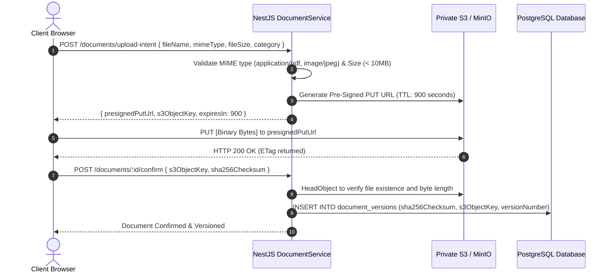

# AICTE FlowGuard — Security, Privacy & Compliance Architecture

**Document Control:**
- **Project:** AICTE FlowGuard (Problem Statement ID: 26262)
- **Document Role:** Teammate B (Backend) & Teammate D (Security / QA)
- **Status:** Complete Security Specification
- **Compliance Baseline:** Section 17 of AICTE FlowGuard Implementation Plan & CERT-In Guidelines

---

## 1. Security Architecture Principles

1. **Zero-Trust Client Invariants:** Never accept client-supplied role or scope headers (`x-user-role`, `x-institution-id`). All authorization claims must be verified server-side against cryptographic session tokens and relational database lookups.
2. **Strict Multi-Tenant Scoping:** Possession of a valid user role does not grant carte-blanche access. Operations must pass strict geographical region, institutional ownership, case assignment, or committee roster scope checks.
3. **Private Object Storage with Short-Lived Pre-Signed URLs:** No uploaded regulatory document is publicly accessible. Documents reside in private S3/MinIO buckets, accessible solely via signed, time-limited URLs (maximum 15 minutes TTL).
4. **Append-Only Tamper-Evident Auditing:** Every security- and workflow-relevant action creates an immutable log record capturing actor identity, client IP, action type, resource ID, and before/after JSON states.
5. **No AI Statutory Decision-Making:** Architectural separation strictly bars automated agents or LLMs from executing statutory approvals or rejections.

---

## 2. Server-Side RBAC & Scope Guards

### 2.1 NestJS Scope Guard Implementation

```typescript
// apps/api/src/common/guards/scope.guard.ts
import { Injectable, CanActivate, ExecutionContext, ForbiddenException } from '@nestjs/common';
import { Reflector } from '@nestjs/core';
import { PrismaService } from '../../prisma/prisma.service';

@Injectable()
export class ScopeGuard implements CanActivate {
  constructor(
    private readonly reflector: Reflector,
    private readonly prisma: PrismaService,
  ) {}

  async canActivate(context: ExecutionContext): Promise<boolean> {
    const request = context.switchToHttp().getRequest();
    const user = request.user;
    const params = request.params;

    if (!user) {
      throw new ForbiddenException('User unauthenticated');
    }

    // System Admins and Auditors have broad read/management scopes but no statutory powers
    if (user.roles.includes('ROLE_SYSTEM_ADMIN') || user.roles.includes('ROLE_AUDITOR')) {
      return true;
    }

    const applicationId = params.id || params.applicationId;
    if (applicationId) {
      const application = await this.prisma.application.findUnique({
        where: { id: applicationId },
        select: {
          institutionId: true,
          regionId: true,
          assignedScrutinyOfficerId: true,
        },
      });

      if (!application) {
        throw new ForbiddenException('Application not found');
      }

      // Check Institution Scope
      if (user.roles.includes('ROLE_INSTITUTION')) {
        if (application.institutionId !== user.institutionId) {
          throw new ForbiddenException('Cross-institution access is strictly prohibited');
        }
      }

      // Check Regional Officer Scope
      if (user.roles.includes('ROLE_REGIONAL_OFFICER')) {
        if (application.regionId !== user.regionId) {
          throw new ForbiddenException('Cross-region case access is prohibited');
        }
      }

      // Check Scrutiny Officer Case Assignment Scope
      if (user.roles.includes('ROLE_SCRUTINY_OFFICER')) {
        if (application.assignedScrutinyOfficerId !== user.id) {
          throw new ForbiddenException('You are not assigned as the Scrutiny Officer for this case');
        }
      }
    }

    return true;
  }
}
```

---

## 3. Secure Document Handling & Pre-Signed URL Lifecycle

### 3.1 Pre-Signed Upload Pattern
To prevent passing massive binary payloads through the Node.js API thread pool, documents are uploaded directly from the client browser to private S3/MinIO storage using pre-signed PUT URLs:



### 3.2 Secure Pre-Signed Download Pattern
When an authorized officer reviews evidence in the scrutiny workspace:
- The API verifies that the officer has read permission for that specific case.
- The API requests a pre-signed GET URL with `response-content-disposition: inline` and a maximum lifetime of **15 minutes**.
- The pre-signed URL includes mandatory IP/security constraints where supported by the storage engine.

---

## 4. File Validation & Malware Defense

Before any uploaded file is accepted by the platform:
1. **File Type Whitelist:**
   - PDF: `application/pdf`
   - Images: `image/jpeg`, `image/png` (strictly for EVC geotagged photos)
   - Disallowed: All executable extensions (`.exe`, `.sh`, `.bat`, `.js`, `.py`, `.zip`, `.tar`).
2. **Magic Byte Verification:** The backend confirms file magic bytes:
   - PDF: `%PDF-` (`0x25 0x50 0x44 0x46`)
   - JPEG: `0xFF 0xD8 0xFF`
   - PNG: `0x89 0x50 0x4E 0x47`
3. **File Size Limits:** Maximum 10MB per document; maximum 50MB for video recordings.
4. **Integrity Hashes:** SHA-256 checksums are calculated on client upload and re-verified on the server to prevent data corruption or in-flight tampering.

---

## 5. Security & Privacy Checklist Summary

| Verification Item | Implementation Standard | Verification Method |
| :--- | :--- | :--- |
| **Authentication** | JWT Bearer / HTTP-Only Secure Cookies with SameSite=Lax | Automated Security Test `SEC-01` |
| **Authorization** | NestJS `@UseGuards(JwtAuthGuard, RolesGuard, ScopeGuard)` | Automated API Guard Tests |
| **Rate Limiting** | 100 requests per minute per IP using `@nestjs/throttler` | Load test with 429 response check |
| **CORS Policy** | Restricted strictly to configured frontend origin; credentials allowed | Security header verification |
| **Secrets Management** | Environment variables via `.env` excluded from git (`.gitignore`) | Git pre-commit secret scanning |
| **SQL Injection** | Parameterized queries enforced natively by Prisma ORM | Static code analysis |
| **XSS Prevention** | Strict CSP headers via Helmet; sanitized HTML in Next.js | Browser security audit |
| **Data Privacy** | All synthetic data for demonstrations; zero real personal information | Privacy policy audit |
