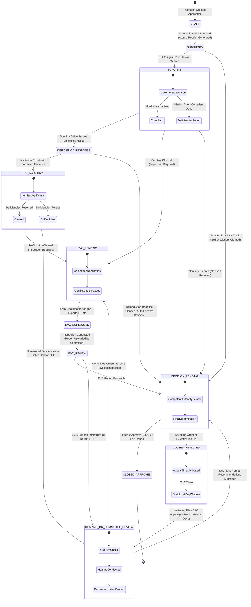
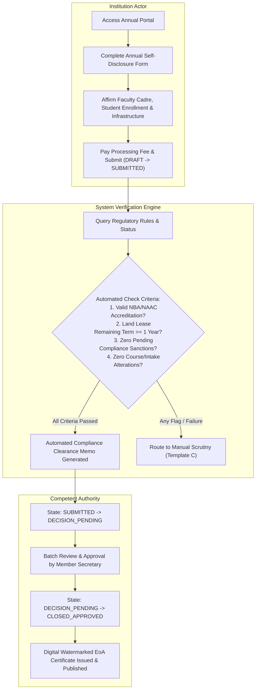
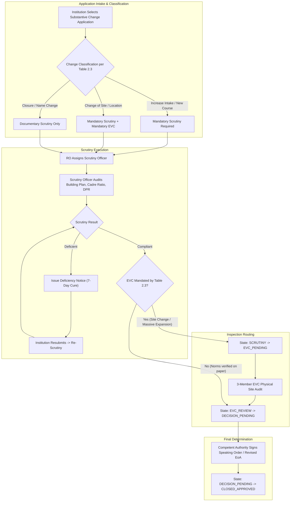
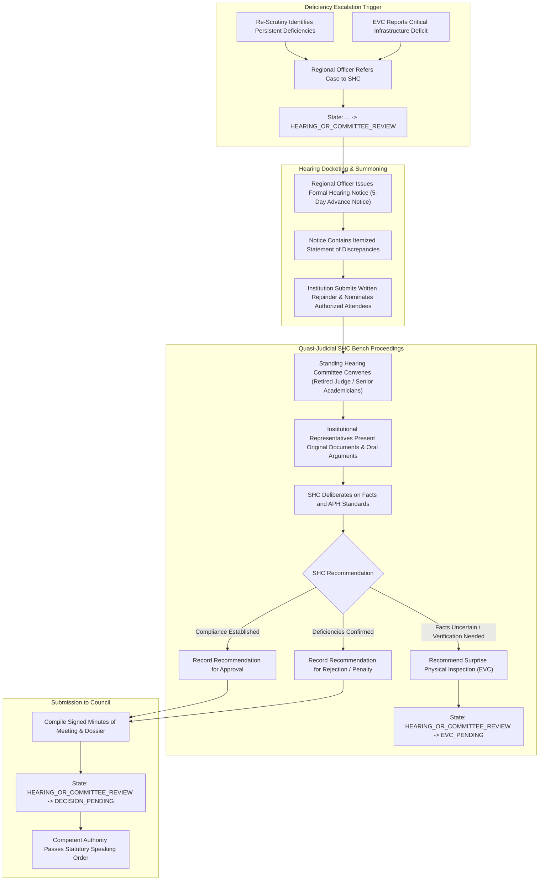
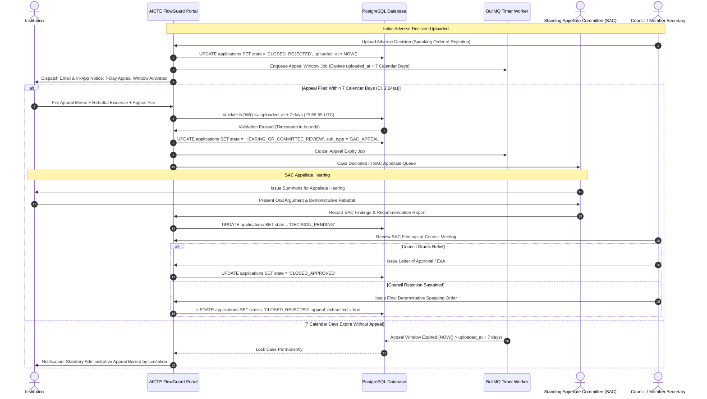
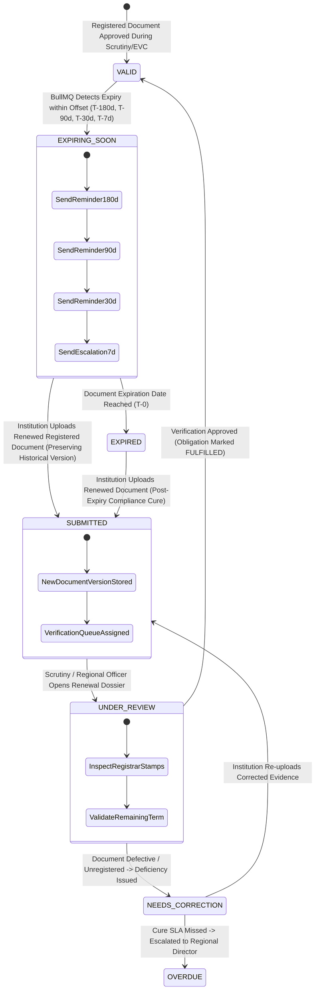
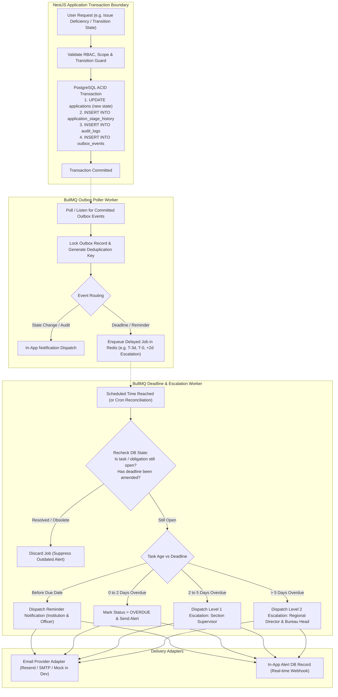

# AICTE FlowGuard — Workflow State Diagrams & Pathways

**Document Control:**
- **Project:** AICTE FlowGuard (Problem Statement ID: 26262)
- **Document Role:** Teammate 1 (Product / APH Mapping)
- **Status:** Baseline Approved
- **Primary Source:** AICTE Approval Process Handbook (APH) 2024–2027

---

## 1. Master Application State Machine

This master finite state machine (FSM) governs all application cases in the AICTE FlowGuard platform. Individual application templates activate specific subsets of these states and transitions.

---

## 2. Template A: New Technical Institution / Letter of Approval (LoA)

Mapped directly from **APH Chapter I (Clauses 1.3 to 1.12)**. Requires mandatory documentary scrutiny, physical infrastructure verification via EVC, and final authorization by the Executive Committee / Competent Authority.

```mermaid
flowchart TD
    subgraph Institution["Institution Actor"]
        A1["Create Draft Application (Chap I)"] --> A2["Upload Land, Building, Finance Evidence"]
        A2 --> A3["Pay Processing Fee & Submit Application"]
    end

    subgraph Intake["Regional Office / Intake"]
        A3 --> B1["Automated Intake Check & Hash Generation"]
        B1 --> B2["Application Number Generated: DRAFT -> SUBMITTED"]
        B2 --> B3["RO Assigns Scrutiny Officer"]
    end

    subgraph Scrutiny["Scrutiny Stage"]
        B3 --> C1["Scrutiny Officer Evaluates Land, Plan & NOCs"]
        C1 --> C2{"Deficiencies Identified?"}
        C2 -- Yes --> C3["Issue Itemized Deficiency Notice: SUBMITTED -> DEFICIENCY_RESPONSE"]
        C2 -- No --> C4["Scrutiny Clearance: SCRUTINY -> EVC_PENDING"]
    end

    subgraph Remediation["Deficiency & Re-Scrutiny"]
        C3 --> D1["Institution Uploads Rectified Evidence (7-day SLA)"]
        D1 --> D2["Resubmission: DEFICIENCY_RESPONSE -> RE_SCRUTINY"]
        D2 --> D3["Scrutiny Officer Performs Targeted Re-Scrutiny"]
        D3 --> D4{"Deficiencies Resolved?"}
        D4 -- Yes --> C4
        D4 -- No --> D5["Case Referred to SHC: RE_SCRUTINY -> HEARING_OR_COMMITTEE_REVIEW"]
    end

    subgraph EVC["Expert Visit Committee (EVC)"]
        C4 --> E1["EVC Coordinator Schedules Date & Appoints 3 Experts"]
        E1 --> E2["State: EVC_PENDING -> EVC_SCHEDULED"]
        E2 --> E3["EVC Conducts On-Site Physical Inspection"]
        E3 --> E4["EVC Uploads Signed Report, Geotagged Photos & Video Link"]
        E4 --> E5["State: EVC_SCHEDULED -> EVC_REVIEW"]
        E5 --> E6{"EVC Recommends Approval?"}
        E6 -- Yes --> E7["Forward Dossier: EVC_REVIEW -> DECISION_PENDING"]
        E6 -- No --> D5
    end

    subgraph Decision["Competent Authority (Council / EC)"]
        E7 --> F1["Executive Committee Reviews Dossier"]
        D5 --> F2["SHC Conducts Hearing & Records Recommendation"]
        F2 --> F1
        F1 --> F3{"Final Statutory Determination"}
        F3 -- Approved --> F4["Issue Letter of Approval (LoA): DECISION_PENDING -> CLOSED_APPROVED"]
        F3 -- Rejected --> F5["Issue Speaking Order of Rejection: DECISION_PENDING -> CLOSED_REJECTED"]
    end
```

---

## 3. Template B: Routine Extension of Approval (EoA) via Self-Disclosure

Mapped from **APH Chapter II (Clauses 2.1 to 2.4 and Table 2.3)**. Applies to existing, accredited/compliant institutions with no structural, programmatic, or intake changes.

---

## 4. Template C: Extension of Approval with Substantive Changes

Mapped from **APH Chapter II (Clauses 2.5–2.14 and Table 2.3)**. Governs expansion of intake, addition of new programs/courses, change of site, or change of trust name.

---

## 5. Template D: Deficiency, Re-Scrutiny & Standing Hearing Committee (SHC)

Mapped from **APH Chapter II (Clauses 2.19 to 2.21)**. Governs the quasi-judicial hearing pathway when documentary deficiencies or physical EVC shortcomings cannot be resolved through administrative re-scrutiny.

---

## 6. Template E: Standing Appellate Committee (SAC) & Council Appeal Pathway

Mapped strictly from **APH Chapter II, Clause 2.24(a), (b), and (c)**.

---

## 7. Document Validity & Lease Renewal Lifecycle

Governs ongoing institutional compliance, tracking long-term land leases, fire safety NOCs, structural certificates, and NBA accreditation validity.

---

## 8. Outbox, BullMQ, Notification & Escalation Event Flow

Ensures zero message loss, atomic updates, idempotent execution, and automated escalation across system boundaries.

